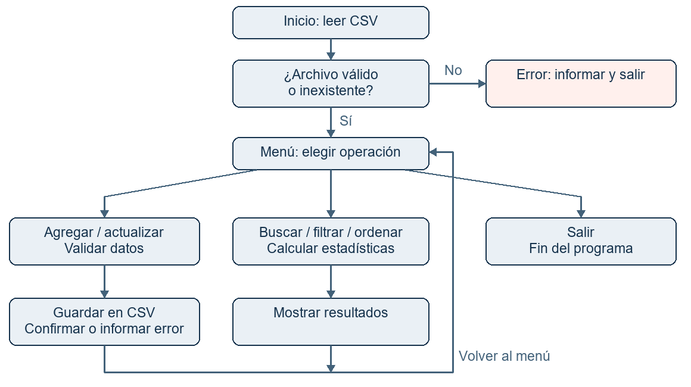
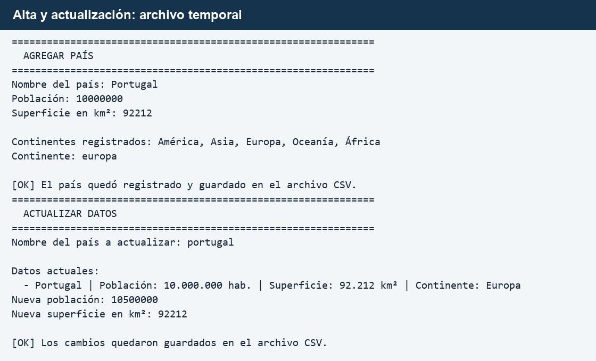
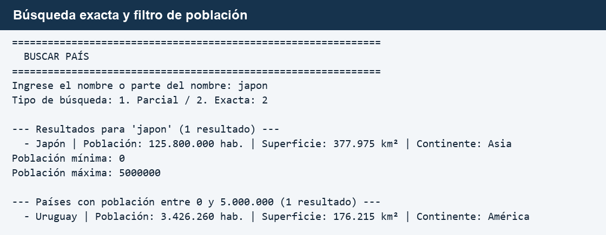
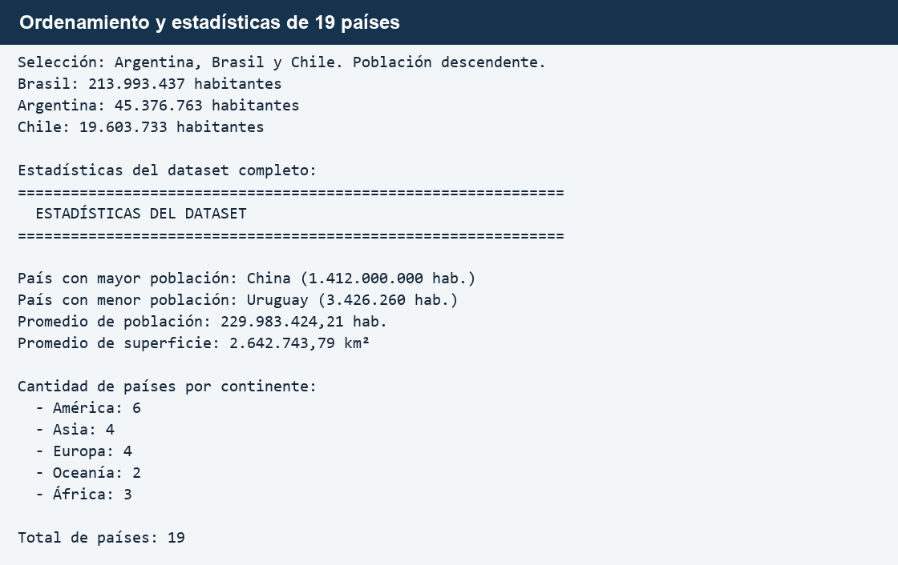
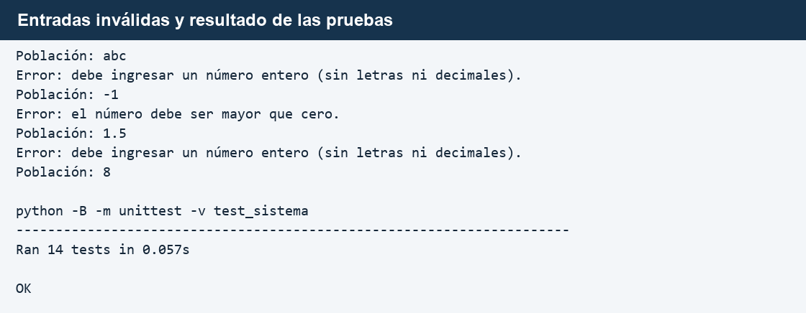

# Gestión de Datos de Países en Python

Trabajo Práctico Integrador - Programación 1

Universidad Tecnológica Nacional

Tecnicatura Universitaria en Programación a Distancia

Comisión 4

Integrantes: Facundo Piriz, Francisco Ruiz, Agustin Tromba y Fausto Rivero

Fecha de entrega: 16 de noviembre de 2026

Aplicación de consola para gestionar países mediante archivos CSV, búsquedas, filtros, ordenamientos y estadísticas.

Repositorio: https://github.com/aqussti/tpi-programacion-i-utn

---page---

## Índice

1. Introducción y alcance .......................................................... 3
2. Marco teórico ........................................................................ 4
3. Ordenamientos y estadísticas ................................................ 5
4. Decisiones técnicas y arquitectura ........................................ 6
5. Pruebas y evidencias de ejecución ......................................... 7
6. Resultados, dificultades y conclusiones .................................. 9
7. Bibliografía, enlaces y entrega .............................................. 10

El informe documenta el estado del programa al 15/11/2026. El código, el dataset y los recursos utilizados en las evidencias están incluidos en el repositorio. La grabación del video grupal se encuentra pendiente y debe completarse antes de la entrega.

---page---

## 1. Introducción y alcance

El proyecto permite administrar información demográfica y geográfica de países desde una consola. Su objetivo es aplicar los contenidos de Programación 1 en un sistema que conecte lectura de archivos, validación de entradas, procesamiento de colecciones y presentación de resultados.

La información se guarda en un CSV con cuatro columnas: nombre, población, superficie y continente. El dataset base contiene 19 países. Las cifras se utilizan como datos académicos de prueba y no se presentan como una actualización demográfica oficial. Las estadísticas describen únicamente los registros cargados.

El usuario puede agregar un país, actualizar su población y superficie, buscar por nombre, filtrar por continente o intervalos numéricos, ordenar resultados y consultar indicadores. Las operaciones de consulta no modifican el dataset. Las altas y actualizaciones se guardan inmediatamente cuando los datos son válidos y la escritura resulta exitosa.

### 1.1 Objetivos específicos

- Representar los países con una lista de diccionarios.
- Separar las responsabilidades mediante funciones y módulos.
- Evitar campos vacíos, duplicados y valores numéricos inválidos.
- Realizar búsquedas parciales y exactas, filtros inclusivos y ordenamientos en ambos sentidos.
- Calcular máximos, mínimos, promedios y frecuencias por continente.
- Mantener los datos en CSV y comunicar los errores sin sobrescribir información inválida.

### 1.2 Alcance y ejecución

El sistema funciona localmente y utiliza solo la biblioteca estándar de Python. No requiere cuentas, conexión a Internet ni instalación de dependencias para ejecutarse. No contempla usuarios simultáneos, una interfaz gráfica ni una base de datos externa.

Para iniciar se ejecuta `python main.py` desde la carpeta del proyecto. Las pruebas se ejecutan con `python -B -m unittest -v test_sistema`. Se utilizó Python 3.14 para las verificaciones y se revisó la sintaxis con compatibilidad para Python 3.8.

### 1.3 Distribución de responsabilidades

Facundo Piriz: datos, persistencia y dataset; teoría de listas, diccionarios y CSV. Francisco Ruiz: consultas y validaciones; funciones, condicionales y flujo. Agustin Tromba: ordenamiento, estadísticas, repositorio y README; teoría y decisiones técnicas. Fausto Rivero: menú e integración; armado del informe y coordinación de video y entrega. La revisión final reúne estas partes en un único programa.

---page---

## 2. Marco teórico

### 2.1 Listas y diccionarios

Una lista es una colección ordenada y mutable; permite agregar elementos, recorrerlos y obtener su cantidad con `len`. Un diccionario asocia claves con valores. En el proyecto, cada país tiene las claves `nombre`, `poblacion`, `superficie` y `continente`; la lista principal reúne esos diccionarios. Esta organización permite recorrer países sin mantener listas paralelas que podrían perder su correspondencia [1].

Ejemplo de registro: `{"nombre": "Argentina", "poblacion": 45376763, "superficie": 2780400, "continente": "América"}`. La población y la superficie se convierten a enteros durante la lectura, de modo que las comparaciones posteriores sean numéricas.

Las consultas devuelven listas nuevas con referencias a los registros originales. El ordenamiento copia la lista, pero no duplica cada diccionario; por eso sus resultados se tratan como consultas y no se modifican directamente. Las actualizaciones preparan copias de los registros antes de guardar.

### 2.2 Funciones, condicionales y ciclos

Una función agrupa una operación que puede recibir parámetros y devolver un resultado. La división en módulos permite reutilizar la misma lógica desde el menú y las pruebas. Por ejemplo, `buscar_por_nombre(paises, texto, exacta=True)` devuelve las coincidencias sin imprimirlas; el menú decide cómo mostrarlas [2].

Las estructuras `if`, `elif` y `else` seleccionan el comportamiento según la opción o los datos. Los ciclos `for` recorren los países; `while` mantiene activo el menú y repite solicitudes de entrada hasta obtener un valor válido. La opción de salida interrumpe el ciclo principal. Las excepciones distinguen errores de datos y de archivos de un resultado de búsqueda vacío.

### 2.3 Archivos CSV

CSV es un formato de texto tabular. La primera fila contiene los encabezados y cada fila siguiente representa un país. `csv.DictReader` permite interpretar filas como diccionarios y `csv.DictWriter` escribirlos respetando las columnas. Se abre el archivo con `newline=""` y codificación UTF-8; en la lectura se admite también la marca BOM mediante `utf-8-sig` [3].

La aplicación exige el orden `nombre,poblacion,superficie,continente`. Rechaza columnas incorrectas, campos faltantes o adicionales, registros duplicados y valores inválidos. Un CSV con solo el encabezado representa una lista vacía válida. Un archivo existente dañado detiene el inicio con un mensaje; no se confunde con una lista vacía que pueda reemplazarse.

### 2.4 Validación y normalización

Los textos obligatorios no pueden quedar vacíos. Población y superficie deben ser enteros positivos; los filtros admiten cero e incluyen sus extremos. Los nombres se comparan sin mayúsculas ni tildes, por lo que `japon` encuentra `Japón`. Los continentes se convierten a una escritura común: `america`, `AMÉRICA` y `América` forman el mismo grupo. Los continentes desconocidos se rechazan.

---page---

## 3. Ordenamientos y estadísticas

### 3.1 Ordenamiento por inserción

Ordenar reorganiza una colección según una clave y un sentido. El programa admite nombre, población o superficie; el sentido puede ser ascendente o descendente. Aunque Python ofrece `sorted()` y `list.sort()` [4], el módulo implementa inserción manual para practicar comparaciones, ciclos y desplazamientos.

El recorrido comienza en el segundo país. Se guarda temporalmente el registro actual y se lo compara con los anteriores. Los elementos que deben quedar después se desplazan una posición, hasta encontrar el lugar donde insertar el país guardado. La parte inicial de la lista queda ordenada en cada iteración.

Con las poblaciones `30, 10, 20`, el primer paso produce `10, 30, 20`; el siguiente produce `10, 20, 30`. Para invertir el sentido se invierte la comparación. Los valores iguales no se desplazan entre sí, manteniendo la estabilidad del ordenamiento.

La función trabaja sobre una copia superficial y no altera el orden original. El peor caso requiere O(n²) operaciones; si la lista ya está ordenada, el recorrido es O(n). La copia ocupa O(n) memoria adicional. Con 19 países se prioriza una implementación clara; para colecciones mucho mayores sería conveniente utilizar el ordenamiento incorporado de Python.

Los nombres se comparan con `casefold()`, conservando sus tildes. Por lo tanto, el orden de texto no pretende reproducir las reglas alfabéticas de una región. Esta decisión es independiente de la búsqueda, que sí ignora tildes.

### 3.2 Indicadores estadísticos

El máximo y el mínimo de población se obtienen recorriendo la lista. El primer registro sirve como referencia y se reemplaza cuando aparece un valor mayor o menor. En un empate se conserva el primer país encontrado.

La media aritmética se calcula como suma de valores dividida por cantidad [5]. Se calcula por separado para población y superficie; cada país tiene el mismo peso. Los resultados pueden ser decimales aunque los datos originales sean enteros. El menú muestra dos decimales, sin redondear los valores almacenados.

El conteo por continente utiliza un diccionario de frecuencias: cada continente es una clave y su valor aumenta por cada país. La normalización se realiza antes de almacenar los registros, evitando grupos duplicados por diferencias de escritura.

Sin países, máximos, mínimos y promedios devuelven `None`; las frecuencias devuelven `{}`. Así se evita dividir por cero y se distingue la falta de datos de un resultado numérico real. Cada función estadística realiza un recorrido lineal; el conjunto de indicadores mantiene un costo O(n).

---page---

## 4. Decisiones técnicas y arquitectura

`main.py` coordina el menú y presenta resultados. `datos.py` valida registros y administra el CSV. `consultas.py` contiene búsqueda y filtros. `validaciones.py` reúne entradas interactivas, conversión de enteros y normalización. `ordenar.py` y `estadisticas.py` procesan la lista sin acceder al archivo.

Las funciones se integran respetando sus nombres y retornos. Las consultas siempre devuelven listas; altas y actualizaciones devuelven un booleano; las estadísticas devuelven un diccionario. Esto evita adaptaciones ambiguas entre módulos.

### 4.1 Protección de los datos

Antes de guardar se validan todos los registros. Se escribe un archivo temporal en la misma carpeta y se reemplaza el CSV original solo al terminar correctamente. La memoria se actualiza después del guardado. Un fallo de escritura conserva tanto la lista como el archivo anterior. El sistema no está diseñado para escrituras simultáneas de varias instancias.

La ruta del dataset se determina desde la ubicación de `datos.py`; no depende de la carpeta actual de la terminal. Un archivo faltante permite comenzar una lista nueva; uno inválido exige corregir los datos antes de continuar.

### 4.2 Flujo de operaciones

Figura 1. Inicio, lectura, validación, selección de operaciones, guardado y retorno al menú. Las consultas recorren los datos en memoria; solo altas y actualizaciones escriben el archivo.

---page---

## 5. Pruebas y evidencias de ejecución

Las pruebas usan el dataset base y archivos temporales independientes. No modifican los 19 registros de entrega. Se comprueban resultados y efectos sobre memoria y archivos, incluyendo un fallo simulado de reemplazo del CSV.

La suite `test_sistema.py` contiene 14 pruebas. Verifica alta y actualización persistentes, normalización y duplicados, rechazo de valores inválidos, CSV malformado, conservación de datos ante fallos, búsquedas, filtros inclusivos, seis ordenamientos, estabilidad, estadísticas, listas vacías, validaciones interactivas y recorrido del menú hasta salir.

Las imágenes siguientes reproducen la salida real capturada de las funciones de consola durante ejecuciones controladas con entradas de prueba; no son maquetas de resultados esperados. Las operaciones de escritura se ejecutaron sobre una copia temporal. Se incluyen los textos originales junto a las imágenes en `documentacion`.

Figura 2. Alta de Portugal y actualización de su población sobre una copia de prueba. Los cambios se volvieron a leer desde el CSV para comprobar persistencia.

Figura 3. Búsqueda exacta de `japon` y filtro de población entre cero y cinco millones: Japón y Uruguay, respectivamente.

---page---

### 5.1 Ordenamiento, estadísticas y errores

Figura 4. Ordenamiento descendente de una selección y estadísticas del dataset base completo. China tiene la mayor población y Uruguay la menor. Los promedios se muestran con dos decimales.

Figura 5. Rechazo de una entrada no numérica, un valor negativo y un decimal antes de aceptar un entero. Resumen de la suite de pruebas ejecutada.

También se verificó que un CSV inválido impida continuar sin sobrescribirlo y que una lista vacía produzca mensajes informativos. La suite puede repetirse con el comando documentado en el README.

---page---

## 6. Resultados, dificultades y conclusiones

### 6.1 Resultados con el dataset base

El dataset contiene 19 países: América 6, Europa 4, Asia 4, África 3 y Oceanía 2. La población máxima corresponde a China con 1.412.000.000 habitantes y la mínima a Uruguay con 3.426.260. El promedio de población es 229.983.424,21 habitantes y el de superficie es 2.642.743,79 km². Estos valores dependen exclusivamente del CSV incluido.

Las verificaciones cubren las operaciones mínimas solicitadas: alta, actualización, búsqueda parcial y exacta, filtros por continente y rangos, ordenamientos en ambos sentidos y estadísticas. Las entradas inválidas se informan mediante mensajes y no se guardan.

### 6.2 Dificultades técnicas y soluciones

La primera dificultad de integración fue la diferencia entre los nombres de funciones importados por el menú y los definidos en consultas y validaciones. Esto impedía iniciar el programa. Se ajustaron las importaciones y llamadas y se añadió una prueba que recorre el menú completo.

Otra dificultad fue la escritura variable de los continentes: cambiar solo las mayúsculas no unificaba `America` y `América`. Se centralizó la normalización y se utiliza tanto en carga como en alta y guardado. La prueba comprueba que un país agregado con `america` incremente el grupo América.

La lectura de un archivo dañado podía confundirse con la ausencia de países. Se separaron ambos estados: un archivo inválido produce un error y detiene el inicio; un CSV válido con encabezado y sin filas produce una lista vacía. También se evitó reemplazar el original antes de terminar la escritura, y se comprobó que un fallo mantenga los datos anteriores.

### 6.3 Conclusiones

El proyecto muestra cómo conectar estructuras básicas de Python en una aplicación completa. La lista de diccionarios facilita el recorrido y mantiene juntos los atributos de cada país. La división en funciones permite razonar sobre cada operación y comprobar sus resultados de forma independiente.

La integración demostró que contar con módulos terminados no alcanza: deben coincidir los nombres, parámetros, tipos y responsabilidades. Las pruebas del menú y de persistencia permiten detectar fallas que no aparecen al revisar una función aislada. La validación y la normalización también forman parte de la corrección de los resultados, especialmente al agrupar estadísticas.

El sistema tiene un alcance deliberadamente acotado: consola, un archivo CSV y ejecución local. Como mejoras futuras pueden considerarse más indicadores, exportación de consultas y almacenamiento en una base de datos si aumenta el volumen o aparece la necesidad de usuarios simultáneos. Esas mejoras no son necesarias para las funcionalidades requeridas en este trabajo.

---page---

## 7. Bibliografía, enlaces y entrega

### 7.1 Fuentes consultadas

[1] Python Software Foundation. Estructuras de datos. Documentación oficial de Python. https://docs.python.org/es/3/tutorial/datastructures.html

[2] Python Software Foundation. Más herramientas para control de flujo. Documentación oficial de Python. https://docs.python.org/es/3/tutorial/controlflow.html

[3] Python Software Foundation. csv: lectura y escritura de archivos CSV. Documentación oficial de Python. https://docs.python.org/es/3/library/csv.html

[4] Python Software Foundation. Sorting Techniques. Documentación oficial de Python. https://docs.python.org/es/3/howto/sorting.html

[5] Python Software Foundation. statistics: funciones de estadística matemática. Documentación oficial de Python. https://docs.python.org/es/3/library/statistics.html

Universidad Tecnológica Nacional. Consigna del Trabajo Práctico Integrador de Programación 1: Gestión de Datos de Países en Python. Documento provisto por la cátedra.

Consulta de documentación web: 15 de noviembre de 2026. Las referencias respaldan los conceptos utilizados; los datos del CSV se presentan como un conjunto académico de prueba.

### 7.2 Acceso al proyecto

Repositorio: https://github.com/aqussti/tpi-programacion-i-utn

Informe PDF: https://github.com/aqussti/tpi-programacion-i-utn/blob/main/Informe_TPI.pdf

Video demostrativo: pendiente de grabación y publicación por el grupo. Se incluye `Guion_video.md` con un recorrido de aproximadamente doce minutos, distribuido entre los cuatro integrantes. Antes de entregar, incorporar aquí y en el README el enlace con acceso sin iniciar sesión.

### 7.3 Contenido de la entrega

El paquete contiene los seis módulos del programa, el dataset, el README, las pruebas, este informe en PDF y Markdown, el diagrama y las salidas capturadas. La carpeta de aportes conserva los textos individuales como material de respaldo.

El cierre de la entrega requiere grabar el video, comprobar su acceso público, actualizar sus enlaces y regenerar el ZIP con esa versión definitiva.
